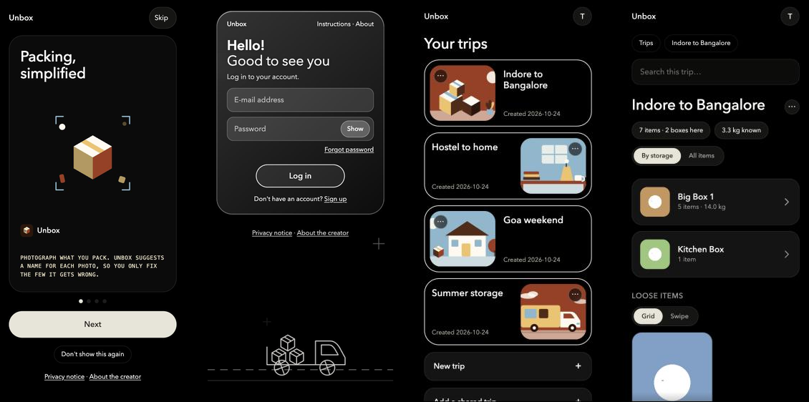

# Unbox

**Scan a QR code on a box and see what's inside, before you open it.**

Unbox is a small web app for people who move house, hostel or city. Photograph the things you pack, put them in boxes (boxes can hold smaller boxes), print a QR label for each box, and anyone you share it with can scan the label, browse photos by box, or search for an item without unpacking a thing.

> Built out of a real interstate move: 79 items across 3 big boxes, catalogued with photos so the person receiving them can see what's inside before opening anything.



## Two parts, at different stages

| | What it is | Status |
|---|---|---|
| **`app.py`** | The single-owner prototype: boxes inside boxes, photos, search, QR labels. Edited on your own computer. | Works. Used for a real move. |
| **`webapp.py`** | The multi-user version on Supabase (Postgres, Auth, Storage): accounts, trips, boxes inside boxes, items, and private photos. | In progress. Batch photo capture with automatic naming works; sharing is not built yet. |

## The prototype (`app.py`)

- **Boxes inside boxes.** Big boxes hold small boxes and loose items. Counts and weights roll up.
- **Photo-first browsing**, designed for a phone: big tap targets, swipe between items.
- **Search by meaning.** Typing "something to drink from" finds the water bottle and the mug, and "wire for tv" finds the HDMI cable. It uses a small open-source embedding model (`bge-small`, via `fastembed`) that runs on the server's CPU: no paid API, no data sent to a third party.
- **QR labels** for every box, printable on A4.
- **Photo tools:** crop, rotate, and iPhone (HEIC) support.
- **Private by default:** every page and photo sits behind a password, and robots are told not to index it.

Run it on your computer:

```bash
python -m venv .venv && source .venv/bin/activate
pip install -r requirements.txt
python seed_sample.py          # makes a made-up inventory in ./data (placeholder pictures)
EDIT_MODE=1 python app.py      # open http://127.0.0.1:5000
```

The first run downloads the search model (about 100 MB). `EDIT_MODE=1` turns on the editing screens, which only exist on your own machine. Without it the app is read-only and asks for a password (`APP_PASSWORD`).

## The multi-user app (`webapp.py`)

What exists and has been tested against a real Supabase project:

- **Sign-up** with an 18+ confirmation and consent to the privacy notice, saved with a timestamp
- **Email confirmation**, login and logout
- **Forgot password** (the same answer is given whether or not an email has an account)
- **Trips:** create, archive (hidden but kept), restore, delete for good
- **Boxes inside boxes, and items** with a name, tags, a note and a weight. Counts and known weights add up through nested boxes.
- **Private photos:** location data (GPS) and all other hidden metadata are removed on upload, the picture is resized, and it is saved in a private bucket. Photos are shown through links that expire after an hour.
- **Search inside a trip:** exact words, plurals and typos, plus search by meaning ("something to drink from" finds the mug). Meaning search uses a small open-source text model (`bge-small-en-v1.5`, 384 numbers per item) that runs on the server's CPU, and the comparison happens in Postgres with pgvector. Item text never leaves your own server. It does not look at photos.
- **Batch capture with naming suggestions:** choose up to 20 photos at once; each is named by a small open-source model running on the server (only the photo half of the model, compared with a precomputed list of 512 everyday item names), then one review screen lets you fix wrong names with a tap. Anything it doesn't recognise becomes "Unidentified item". Photos are never sent to another company.
- **Share by QR (view only, no account):** the owner turns sharing on for a trip, choosing a password or no password. Labels print a QR for the whole trip and one per box. Scanning shows the trip read-only. With a password, the QR holds only a link and the viewer must type it; passwords are stored hashed, wrong guesses are limited, and changing or turning off sharing ends every existing viewer pass. Without one, anyone who has the QR can look. A **trip code** is different: it copies the trip into a friend's account. The server uses Supabase's secret key for viewing only after the checks.
- **Add your items flow:** one button asks where items go: loose items, or a new sub storage (a box, bag or drawer, named by you). Then photos (named by the AI) or typed in, one after another. Items show as a grid or a swipe view. A loose item dragged (press and hold on a phone) onto a sub storage asks "Move this into …?" and moves on yes.
- **Lock a trip:** once you've added everything, lock it from the trip's ⋯ menu and the owner sees view-only mode too, with no add, edit, delete or drag controls (the server refuses changes as well). Unlock to edit again. **All items** shows every item at once; **By storage** groups them by sub storage.
- **Details under each photo:** in the swipe view every item shows a Details card (weight, tags, note). The owner can add or change weight and note right there, and can enter weights straight after an upload on the review screen. The same card is shown read-only to viewers.
- **Trip codes:** the owner makes a one-time code (shown once, stored only scrambled, valid 7 days, can be switched off). A friend with an account enters it on their Trips page and a full copy of the trip (boxes, items, weights, notes and photos) lands in their account. It is a copy: the viewer password, lock and code are not carried over, and edits on either side don't affect the other. Wrong guesses are limited.
- **Delete my account:** under Profile, after re-entering the password and ticking a box, the account is removed for good with all its trips, items and photos (photos are removed first; if that fails nothing is deleted). Copies a friend already made stay with them.
- **Doodles and tips:** small animated line drawings (box, camera, padlock; they respect "reduce motion") on the home page and empty screens, and a loading screen with a progress bar and rotating usage tips while photos are named, a trip is copied, or an account is deleted.
- **Trip pictures and a greeting:** each trip card shows one of 30 ready-made illustrations (five scenes in six coffee-shop colour sets, drawn by `tools/make_trip_art.py`); a trip keeps its picture and neighbouring trips differ. The owner can pick any illustration or upload their own photo (Trips → ⋯ → Change picture); uploads are cleaned of location data, kept private, and deleted with the trip. After logging in, "Hey <name>, Welcome here" shows for five seconds. The name comes from an optional field at sign-up or Profile → Your name, otherwise from the email address.
- **Editing:** rename a box or item, change its tags, note and weight, replace or remove its photo (removing deletes the file), move it into another box, and rename a trip. Edits refresh the item's search numbers.
- **Delete means delete:** removing an item, a box or a trip also removes its photo files. If the files can't be removed, nothing is deleted.
- **Privacy between users:** the database's row-level rules mean one account cannot see or change another's trips. Every database call is made with the logged-in user's own token, never the server's secret key.
- **Safety basics:** form tokens against forged requests, HttpOnly cookies, no open redirects, and security headers.

Automated tests (166, using an in-memory stand-in for Supabase) cover bad input, wrong passwords, forged links, expired sessions, photo cleaning (including a photo that carries GPS), file deletion, and one user trying to reach another's data. The real database rules were also checked by hand with two accounts:

```bash
pip install -r requirements-dev.txt
pytest
```

To run it you need your own free Supabase project: apply `supabase/schema.sql` in its SQL editor, copy `.env.example` to `.env` and fill in your keys (never commit `.env`), then:

```bash
DEV_HTTP=1 PORT=5050 python webapp.py     # open http://127.0.0.1:5050
```

The password-reset email works end to end, but Supabase's built-in email sender is limited to a few messages an hour on the free plan, so real users need an email provider of their own (see the roadmap).

## Roadmap

The plan and the reasons behind each choice are in [DESIGN.md](DESIGN.md).

- [x] Accounts with email confirmation, consent record, many trips per user, archive and delete
- [x] Hosted database with row-level privacy rules (Supabase)
- [ ] **Own email provider (SMTP)** before opening to the public: the built-in sender is for testing only and its limits and spam placement would block real users
- [x] Boxes, items and photos in the multi-user app, with private storage and short-lived photo links
- [x] **Batch capture:** take photos at your own pace, upload together, review all the suggested names on one screen
- [ ] Weights in the review screen
- [x] **Naming suggestions from photos:** choose up to 20 photos, each becomes an item named by a small open-source model that runs on our own server (nothing goes to an AI company), then fix wrong names on one review screen. First suggestion right about 8 times in 10 on a test set; measured results and limits are in [DESIGN.md](DESIGN.md)
- [ ] Optional cloud boost for naming, only with per-batch consent and a preview of what is sent (not planned yet)
- [ ] "Scan a pile": one photo, objects found and cropped automatically, unknown ones named "Unidentified item"
- [x] A viewer password per trip, so the QR itself carries no secret
- [x] QR labels generated in-app
- [x] Installable on a phone's home screen (web app manifest, icons, a do-nothing service worker that stores no private data)
- [x] A short introduction shown at every login until the person taps "Don't show this again" (saved with the account; always available under Profile → Instructions)
- [x] Location data stripped from every uploaded photo
- [x] Search inside a trip (by meaning, words and typos)
- [x] Editing boxes and items (rename, tags, weight, replace or remove the photo, move between boxes) and renaming trips
- [ ] Measure search quality on a real inventory (top-3 hit rate: keywords vs meaning) and tune the cutoff
- [ ] A multilingual search model, since the current one is English only

## Privacy

Photos from inside a home are sensitive. The design commitments are written down in [DESIGN.md](DESIGN.md), and a draft privacy notice ships with the app. It has not been reviewed by a lawyer.

## Tech

Python · Flask · Supabase (Postgres, Auth, Storage) · SQLite (prototype) · Pillow · fastembed · pytest · Docker · Render

## Licence

MIT. See [LICENSE](LICENSE).
